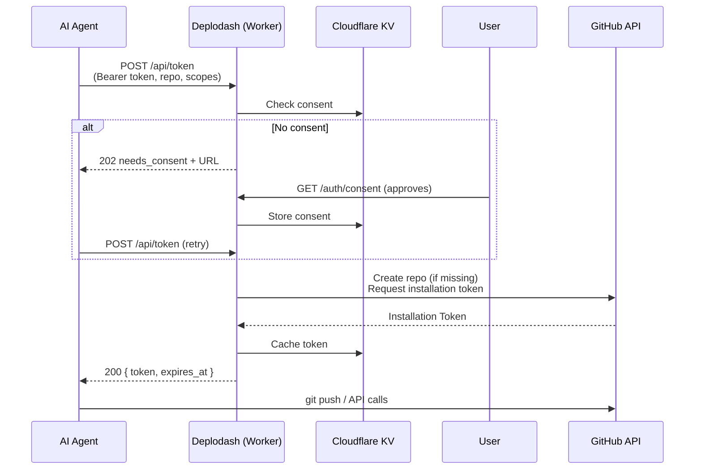

[](https://deepwiki.com/concertypin/deplodash)

# 🤖 Deplodash — GitHub App Token Service

Issue scoped GitHub Installation Tokens to AI agents for git push and API access.
Built with Hono on Cloudflare Workers.

## Features

- **Agent token API** — AI agents request scoped installation tokens via `POST /api/token`
- **Auto-repo-creation** — When an agent requests a token for a non-existent repo, deplodash creates it automatically
- **Consent management** — Repository owners approve agent access via a web consent page
- **Token caching** — Installation tokens are cached in KV to minimize GitHub API calls
- **OAuth login** — PKCE-based GitHub OAuth for user authentication (consent page only)
- **Scoped permissions** — `contents:read`, `contents:write`, `workflows:write`, `admin`
- **Rate limiting** — Per-agent rate limiting via Cloudflare's native ratelimit binding (100 req/60s)
- **Consent ownership** — Users see and manage only their own consents; cross-user revocation blocked
- **Error safety** — GitHub API error details are sanitized before returning to callers
- **OpenAPI docs** — Auto-generated API documentation at `/docs`

## Quick Start

```sh
pnpm install

# Copy and fill in your credentials
cp .dev.vars.example .dev.vars

pnpm dev     # → http://localhost:5178
pnpm test    # 211 tests
pnpm build   # → dist/
```

## Environment Variables

| Variable                 | Required | Description                                                     |
| ------------------------ | -------- | --------------------------------------------------------------- |
| `GITHUB_CLIENT_ID`       | ✅       | GitHub OAuth App client ID (for consent page auth)              |
| `GITHUB_CLIENT_SECRET`   | ✅       | GitHub OAuth App client secret                                  |
| `CALLBACK_URL`           | ✅       | Full OAuth callback URL (dev: `http://localhost:5178/callback`) |
| `ENCRYPTION_SECRET`      | ✅       | Encryption key for session cookies                              |
| `GITHUB_APP_ID`          | ✅       | GitHub App ID                                                   |
| `GITHUB_APP_PRIVATE_KEY` | ✅       | PEM-encoded RSA private key for the GitHub App                  |
| `GITHUB_TOKEN`           | ❌       | Direct PAT — skips OAuth (dev/testing only)                     |

## How It Works



1. **Agent** sends `POST /api/token` with a pre-provisioned Bearer token, repo, and scope
2. **Deplodash** checks consent in KV → if not yet approved, returns a consent URL
3. **Agent** can optionally wait for consent using the Long Polling endpoint `QUERY /api/wait`
4. **User** visits the consent URL, logs in via OAuth, and approves access
5. **Agent** gets notified (or retries `POST /api/token`), gets a scoped GitHub Installation Token (repo is auto-created if missing)
6. **Agent** uses the token for `git push` or GitHub API calls

## API

### `POST /api/token` — Request an Installation Token

```json
// Request
{ "repo": "owner/repo", "scopes": ["contents:write"] }

// Response (200) — Token issued
{ "status": "ok", "token": "ghs_xxxxxxxxxxxx", "expires_at": "2026-06-14T20:00:00Z" }

// Response (202) — Consent required
{ "status": "needs_consent", "url": "https://.../auth/consent?repo=..." }
```

Available scopes: `contents:read`, `contents:write`, `workflows:write`, `admin`

## Git Credential Helper

For HTTPS `git push`, install the credential helper (Node 24 and Git 2.26 or newer) with one command:

```sh
curl -fsSL https://raw.githubusercontent.com/concertypin/deplodash/main/apps/api/scripts/install-credential-helper.sh | sh
```

Before changing anything it explains the `useHttpPath` side effect below and asks you to confirm. Where it cannot ask (an agent VM, CI, or `curl | sh` on Windows), it stops without changes; rerun with `--yes` to accept: `curl -fsSL https://raw.githubusercontent.com/concertypin/deplodash/main/apps/api/scripts/install-credential-helper.sh | sh -s -- --yes`.

The installer prompts for your agent token, stores it in a private runner under `~/.local/share/deplodash`, and registers the helper for `https://github.com` ahead of every existing credential provider, including system-level ones such as GCM (Git for Windows) or osxkeychain (Apple Git). The providers that were active before stay registered after it as a fallback, and your generic `credential.helper` settings are left untouched. Helpers scoped to a path or user name under github.com, or set through `includeIf`, are reset for github.com; the installer prints a warning when it finds them. The fallback list is copied at install time, so rerun the installer after changing your system or generic credential helper. It does not put the token in Git configuration. It sets `credential.https://github.com.useHttpPath=true`, because Git only tells credential helpers which repository is being accessed when this is set; as a side effect, a fallback provider stores GitHub credentials per repository instead of per host. Because Git does not tell credential helpers which ref is being pushed, the default request conservatively includes both `contents:write` and `workflows:write`; set `DEPLODASH_SCOPES` for an explicit narrower scope set, and `DEPLODASH_REPO_MODE=create-if-missing` to opt in to automatic repository creation. When the helper cannot produce a token (for example consent is pending, or the repository is not managed by Deplodash) it prints a diagnostic to stderr and returns nothing, so Git falls through to your other credential providers instead of stopping. Approve the consent URL printed to stderr, then retry `git push`. Note that Git's approve phase sends the issued token to every configured helper; the installer registers each fallback provider through a small wrapper (`deplodash-credential-fallback.ts`) that runs it exactly as Git would but drops that `store` request for GitHub App installation tokens (`ghs_…`), so fallback providers never cache the short-lived Deplodash token. A credential helper configured in a single repository's own `.git/config` is not wrapped and could still store it; per-repository helpers are rare, so the installer leaves repository config alone. On Windows (no POSIX `/dev/tty`), set `$env:DEPLODASH_AGENT_TOKEN` before running the installer to avoid a visible-input prompt.

## OAuth Setup

Only needed for the consent page authentication:

1. **GitHub** → Settings → Developer settings → OAuth Apps → **New OAuth App**
2. Set **Authorization callback URL** to your app's `/callback`
    - Local: `http://localhost:5178/callback`
    - Production: `https://your-worker.workers.dev/callback`
3. Copy the Client ID and Client Secret to `.dev.vars`

## Architecture

See [`AGENTS.md`](./AGENTS.md) for the full module reference.

## Deploy

```sh
# Set secrets (one-time)
pnpm exec wrangler secret put GITHUB_CLIENT_ID
pnpm exec wrangler secret put GITHUB_CLIENT_SECRET
pnpm exec wrangler secret put CALLBACK_URL
pnpm exec wrangler secret put ENCRYPTION_SECRET
pnpm exec wrangler secret put GITHUB_APP_ID
pnpm exec wrangler secret put GITHUB_APP_PRIVATE_KEY

# Update KV namespace ID in apps/api/wrangler.jsonc, then deploy
pnpm deploy
```

## License

Apache-2.0, see [LICENSE](./LICENSE) for details.
